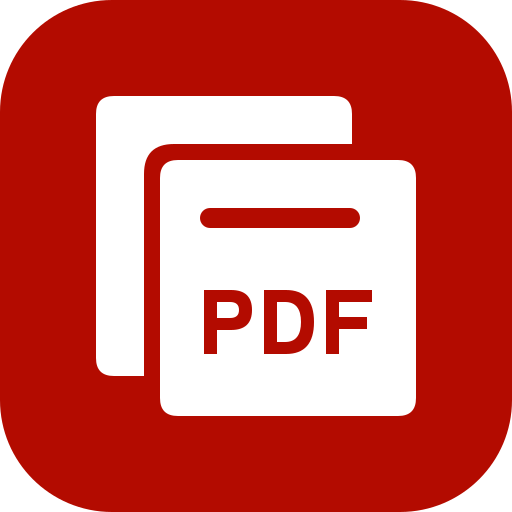

# OpenPDF app icon



The icon uses the original [layered-pages design](concepts/README.md). The white pages and
PDF lettering are outlined geometry on a `#B30B00` rounded tile. The vector uses no fonts
or embedded images. The artwork is licensed under [MIT OR Apache-2.0](LICENSE.txt).

The previous engraved lion icon was original artwork by the PdfCraft project owner.

## Files

| File | What it is |
|---|---|
| `openpdf.svg` | the master vector for the application PNG, `.ico` and `.icns` |
| `openpdf-1024.png` | 1024 px on Apple's grid; also the runtime Dock icon on macOS |
| `openpdf.icns` | macOS icon (16–1024 px) |
| `openpdf.ico` | Windows icon (16–256 px), embedded in `openpdf.exe` by `apps/openpdf/build.rs` |
| `openpdf-document.svg` | Windows PDF file icon master: a Lucide document outline, red badge and outlined PDF lettering; no font dependency |
| `openpdf-document.ico` | Windows PDF file icon (16–256 px), embedded as resource 2 in `openpdf.exe` |
| `hicolor/<n>x<n>/apps/io.github.openscientificsoftware.openpdf.png` | Linux hicolor theme, 16–512 px; the 256 px one is the runtime icon on Windows and Linux |
| `hicolor/scalable/apps/io.github.openscientificsoftware.openpdf.svg` | Linux scalable icon (copy of the master) |

Where it shows: `apps/openpdf/src/main.rs` sets the window icon (Dock, taskbar, Alt-Tab, launcher) and the
Wayland app id `io.github.openscientificsoftware.openpdf`; `packaging/linux/io.github.openscientificsoftware.openpdf.desktop` names the
hicolor icon.

Windows PDF files use resource 2 (`"openpdf.exe",-2`) when OpenPDF is chosen as the default
reader; the app keeps resource 1. The document outline is adapted from Lucide `file-text`
1.49.0 (ISC); its badge and outlined lettering are original (`MIT OR Apache-2.0`), covered by
[LICENSE-document.txt](LICENSE-document.txt). Both icons are embedded, requiring no runtime
sidecar. This provides a file type icon; first-page thumbnails still need a thumbnail provider.

## Regenerate

```sh
packaging/icons.sh        # needs resvg and python3; iconutil (macOS) for the .icns
cargo xtask assets        # then update the sha256 values in ATTRIBUTION.toml and run with --write
```
